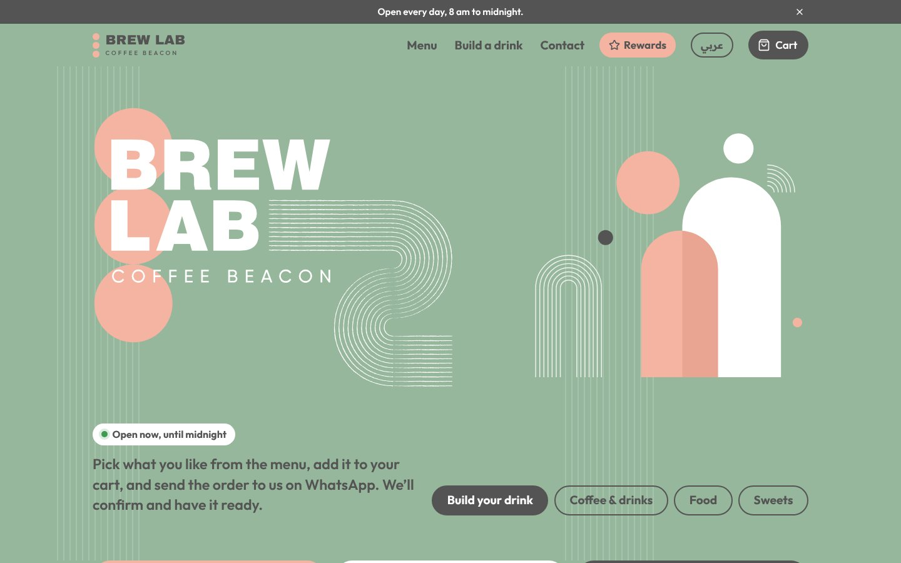
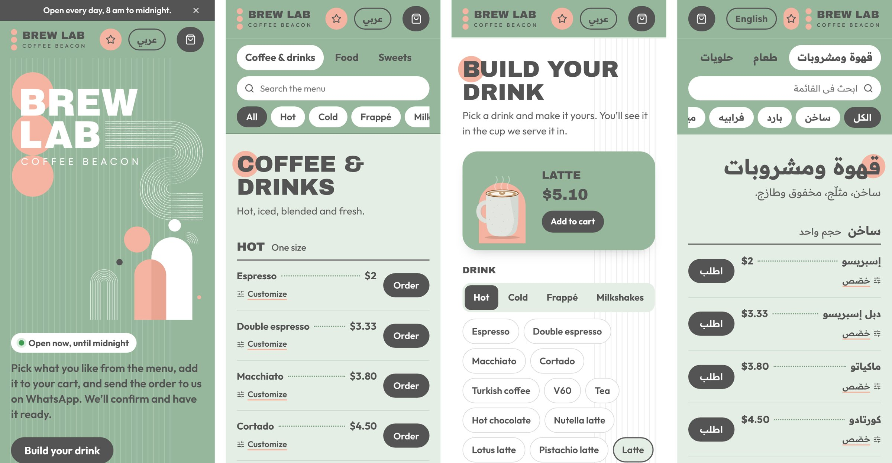

# Brew Lab — ordering, loyalty and admin for a real coffee shop

**Live:** [brewlablb.com](https://brewlablb.com) · Brew Lab Coffee Beacon, Tripoli, Lebanon

I co-own Brew Lab, a coffee shop in Tripoli. I built this website so customers can order from their phones
and so the shop can run its loyalty program and menu without paper cards or a developer.




## The problem

- Orders came in as messy WhatsApp messages: no prices, missing sizes, no pickup time.
- Loyalty was a paper stamp card (buy 7, get the 8th free). Customers lost them, and the shop had no customer data.
- Every menu or price change needed someone technical.
- Many customers prefer Arabic, so an English-only site would have shut them out.

## What I built

| For | Feature |
|---|---|
| Customers | Full menu with prices, search and filters; **Build your drink** with a live animated cup that changes with the drink, milk, flavour, size and dine-in/takeaway |
| Customers | Cart and checkout: pickup or delivery, time, notes. The order is saved with an order number, then sent to the shop on WhatsApp, already formatted |
| Customers | **Rewards**: Google or email-link sign-in, QR loyalty card, points, reward codes, birthday drink |
| Customers | Full **English / Arabic** with right-to-left layout and an Arabic font |
| Staff (`#staff`) | Confirm or cancel orders (points are only added on confirm), scan QR cards with the camera, check reward codes, read feedback |
| Owners (`#editor`) | Change menu, prices, photos, add-ons, opening hours, "Closed today", promos and rewards with no code; customer list with CSV export; staff roles; change history |
| Social media (`#editor`) | A limited role that can only edit promos |

## Tech stack

- **Frontend:** React 19, Vite, Framer Motion (animation), plain CSS with brand variables
- **Backend / data:** Supabase (PostgreSQL, Auth, Storage) with Row Level Security and SQL functions ([`supabase/`](supabase))
- **Hosting:** Netlify, deploys automatically on every push to `main`, custom domain
- **Other:** Google sign-in, QR codes (`qrcode`, `jsqr`), Google search data (schema.org `CafeOrCoffeeShop`), sitemap

## How it works (short version)

```
Browser (React) ── publishable key ──▶ Supabase
   │                                    ├─ Auth (Google, email link)
   │  reads: menu content, own profile  ├─ Tables with Row Level Security
   │  writes: only through SQL functions├─ Functions: place_order, confirm_order,
   │                                    │  redeem_reward, owner_save, …  (role checked inside)
   └─ wa.me link ──▶ WhatsApp           └─ Storage: menu photos
```

- The browser never writes to a table directly. Every change goes through a Postgres function that checks
  who is calling (`is_staff()`, `is_owner()`, `is_social()`), so the security lives in the database, not in the UI.
- Customers can only edit their own name, phone and WhatsApp-offers choice (column-level grants). Points change only
  when staff confirm an order or scan a card, so a customer can't give themselves points.
- The menu ships in the code (`src/data/`) and owners' edits are stored in a `site_content` table and laid on top.
  The site still works if the database is empty or unreachable.

More detail, the design decisions and the trade-offs are in **[docs/HOW-IT-WORKS.md](docs/HOW-IT-WORKS.md)**.

## Results

- Launched November 2026 on the shop's own domain.
- A digital loyalty card and a customer list the shop owns, instead of a paper stamp card.
- The owners and the social media person can update menu, prices and promos themselves.
<!-- Add real numbers here as they come in: orders per week, members signed up, rewards redeemed. -->

## What I'd do next

- **Own backend:** move order and loyalty logic into a Python **FastAPI** service (with tests and Docker), keeping
  Supabase as the database. That's the project I'm building now.
- Automated tests for the SQL functions and checkout flow.
- Daily sales summary on the staff page, monthly database backup.

## Run it locally (Mac)

You need Node.js. In Terminal:

```bash
git clone https://github.com/hadicharif/brewlab-website.git
cd brewlab-website
npm install
npm run dev          # http://localhost:5173
```

The site uses only Supabase's public *publishable* key (`src/config.js`); no secret keys are in this repository.
Shop operations (deploys, database setup) are in [docs/OPERATIONS.md](docs/OPERATIONS.md).

## How I built it

I designed the product from the shop's real needs, and made the product and data decisions. I wrote the code with an AI pair-programmer (Claude Code); its project notes are in `CLAUDE.md`.

---

Hadi Charif · [GitHub](https://github.com/hadicharif) · hadicharif1234@gmail.com

© Brew Lab Coffee Beacon. The code is shared for viewing. The Brew Lab name, logo and photos may not be reused.
